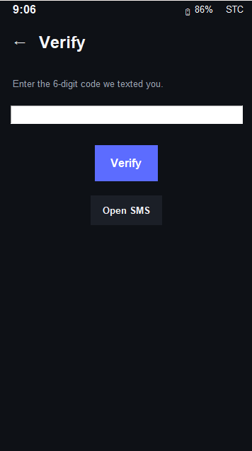
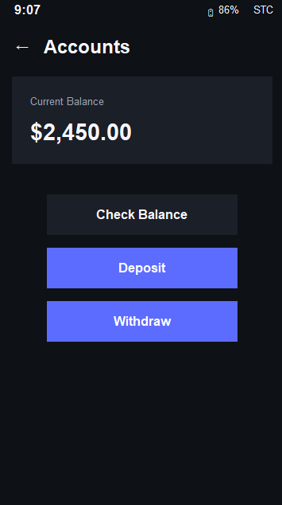
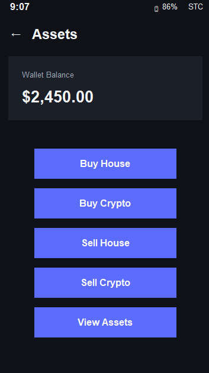

# ✨ Retro Phone Simulator ✨
### *CS50 Python Final Project*

[**Watch the Video Demo** 🎬](https://youtu.be/6SVEP9W7jlI)

 

|  |  |
|:---:|:---:|
|  |  |

---

## ☁️ Description
Hi! This is my final project for **CS50 Python**. It's a nostalgic, non-modern phone simulator application built with **Python** and **Tkinter**. It features a full banking system, assets management, and a  interface! 🎀

### 🛠️ Tech Stack
* **Language:** Python 3 🐍
* **GUI Framework:** Tkinter 🖼️
* **Data Storage:** CSV files 📂
* **User Management:** Multi-user support with separate portfolios 👥

---

## 📂 File Structure

* `phone_sim.py` — The main application heart 💖
* `database.csv` — User data (names, phone numbers, balance, & 2FA codes)
* `logs.csv` — Transaction history log 📝
* `README.md` — Project documentation

---

## 🌸 How to Use

1.  **Start the app:** Run `python phone_sim.py` in your terminal.
2.  **Login:** Open the **Bank App** and sign in with your credentials.
3.  **Verify:** Complete the 2FA verification using the code sent to the **SMS App** 📩.
4.  **Bank:** You can deposit, withdraw, and check your balance anytime! 💸
5.  **Shop:** Use the **Assets App** to buy or sell houses and cryptocurrency 🏠.
6.  **Notifications:** All your transactions will automatically generate cute SMS alerts! ✨

   
  <i>Made with 💖 for CS50</i>

